OOP 2026
```java
public class Homework1 {
    public static void main(String[] args) {

        int i, j;

        for(i=0; i<10; i++) {
            for(j=0; j<=i; j++) {
                System.out.print("*");
            }
            System.out.println();
        }

        System.out.println();

        for(i=0; i<10; i++) {
            for(j=i; j<10; j++) {
                System.out.print("*");
            }
            System.out.println();
        }

        System.out.println();

        for(i=0; i<10; i++) {
            for(j=0; j<9-i; j++) {
                System.out.print(" ");
            }
            for(; j<10; j++) {
                System.out.print("*");
            }
            System.out.println();
        }

        System.out.println();

        for(i=0; i<10; i++) {
            for(j=0; j<i; j++) {
                System.out.print(" ");
            }
            for(; j<10; j++) {
                System.out.print("*");
            }
            System.out.println();
        }
    }
}
```

```java
public class Homework2 {
    public static void main(String[] args) {

        int a = 1, b = 1, c;

        for(int i = 1; i <= 20; i++) {
            System.out.print(a + " ");

            c = a + b;
            a = b;
            b = c;
        }
    }
}
```

```java
public class Homework3 {
    public static void main(String[] args) {

        int a = 1, b = 1, c;
        double ratio;

        for(int i = 3; i <= 20; i++) {
            c = a + b;
            ratio = (double)c / b;

            System.out.println(c + "/" + b + "=" + ratio);

            a = b;
            b = c;
        }
    }
}
```

```java
public class Homework4 {
    public static void main(String[] args) {

        int i, j;

        for(i = 1; i <= 9; i++) {
            for(j = 1; j <= 9; j++) {
                System.out.print(j + "*" + i + "=" + (j * i) + "\t");
            }
            System.out.println();
        }
    }
}
```

```java
public class Homework5 {

    public static void main(String[] args) {

        int i;
        double a = 4.0;
        double pi = 0;

        for(i=1; i<=10000; i=i+2) {

            if(i % 4 == 1) {
                pi = pi + a/i;
            }
            else {
                pi = pi - a/i;
            }
        }

        System.out.println(pi);
    }
}
```
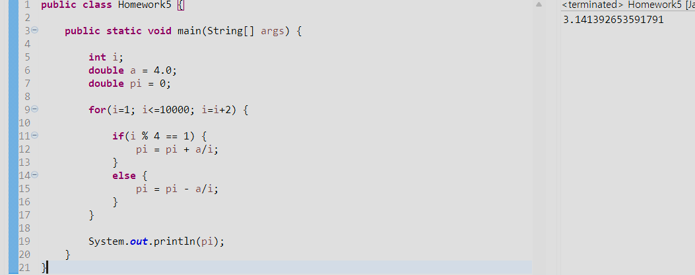
```java
public class Homework5_2 {

    public static void main(String[] args) {

        int i;
        double pi = 0;

        for(i=0; i<100; i++) {

            pi = pi + Math.pow(-1.0/3.0, i) / (2*i+1);

        }

        pi = Math.sqrt(12) * pi;

        System.out.println(pi);
    }
}
```
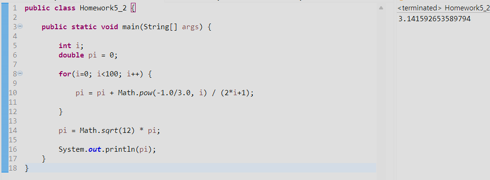
```java
public class Homework6 {

    public static void main(String[] args) {

        int[][] binomial = new int[7][7];

        for(int i = 0; i < 7; i++) {

            for(int j = 0; j <= i; j++) {

                if(j == 0 || j == i) {
                    binomial[i][j] = 1;
                }
                else {
                    binomial[i][j] =
                            binomial[i-1][j-1] + binomial[i-1][j];
                }

                System.out.print(binomial[i][j] + " ");
            }

            System.out.println();
        }
    }
}
```
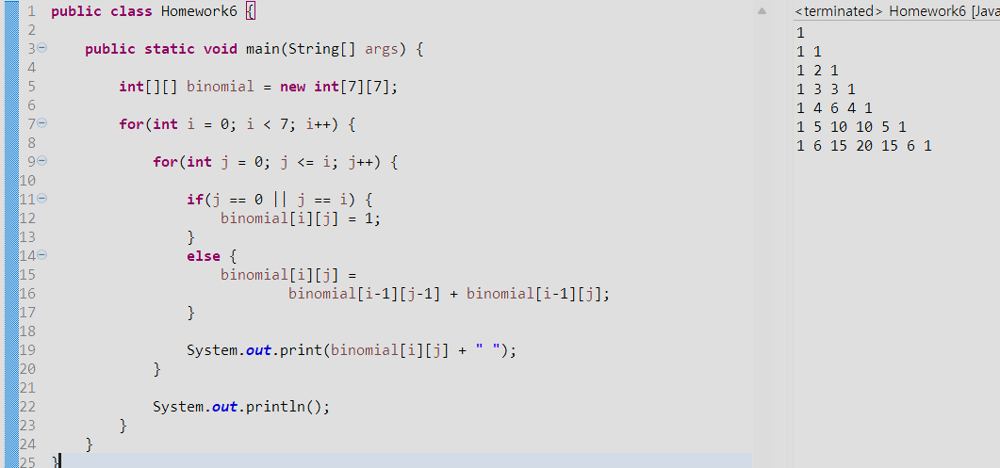
```java

public class Homework7 {

	public static void main(String[] args) {
		int data[] = new int[20];
		for(int i=0; i<20; i++)
		    data[i]=(int)(Math.random()*100);
		for(int i=0; i<20; i++)
		    System.out.print(data[i]+" ");
		
		System.out.println();
		
		for(int i=0; i<19; i++) {

            int min = i;

            for(int j=i+1; j<20; j++) {
                if(data[j] < data[min]) {
                    min = j;
                }
            }

            int temp = data[i];
            data[i] = data[min];
            data[min] = temp;
        }


        System.out.println("정렬 후");

        for(int i=0; i<20; i++) {
        
        	System.out.print(data[i] + " ");
        }
	}
        
}
```
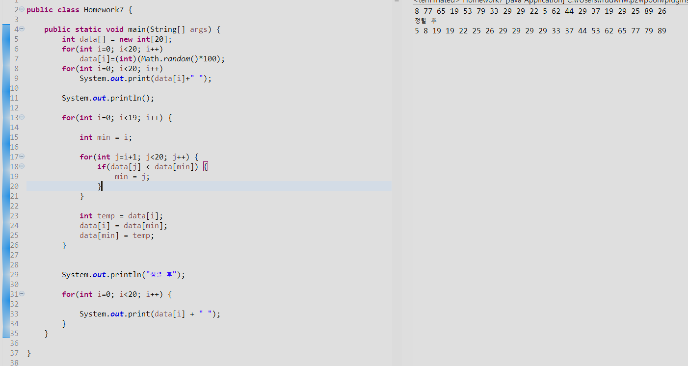
```java
public class Homework8 {

    public static void main(String[] args) {

        int score[][] = new int[30][4];
        int sum;

        for(int i=0; i<30; i++) {

            for(int j=0; j<4; j++) {
                score[i][j] = (int)(Math.random()*101);
            }
        }

        for(int i=0; i<30; i++) {

            sum = 0;

            System.out.print((i+1) + " ");

            for(int j=0; j<4; j++) {
                System.out.print(score[i][j] + " ");
                sum = sum + score[i][j];
            }

            System.out.println("sum=" + sum);
        }
    }
}
```
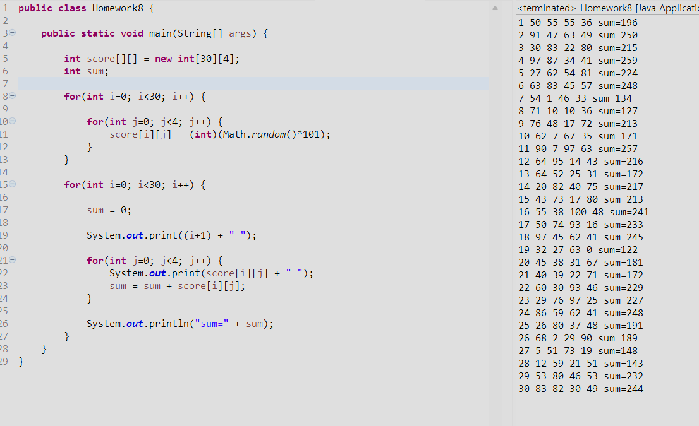


```java
public class Homework10 {

    public static void main(String[] args) {

        int array_count, max_value, bin_size, display_scale, hist_size;

        if(args.length != 4)
            return;

        array_count = Integer.parseInt(args[0]);
        max_value = Integer.parseInt(args[1]);
        bin_size = Integer.parseInt(args[2]);
        display_scale = Integer.parseInt(args[3]);

        hist_size = max_value / bin_size;

        int[] arr = new int[array_count];
        int[] hist = new int[hist_size];

        for(int i=0; i<array_count; i++) {
            arr[i] = (int)(Math.random() * max_value);
        }

        for(int i=0; i<array_count; i++) {
            System.out.print(arr[i] + " ");
        }

        System.out.println();

        for(int i=0; i<array_count; i++) {
            hist[arr[i] / bin_size]++;
        }

        for(int i=0; i<hist_size; i++) {

            System.out.print(
                (i * bin_size) + "~" +
                (i * bin_size + bin_size - 1) + "\t"
            );

            for(int j=0; j<hist[i] / display_scale; j++) {
                System.out.print("#");
            }

            System.out.println();
        }
    }
}
```

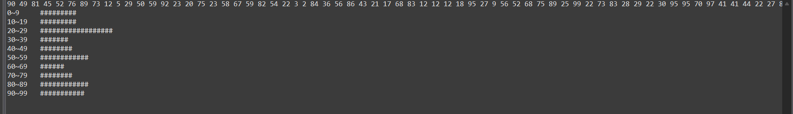


```java
import java.util.Arrays;

public class Homework11 {

    public static void main(String[] args) {

        int array_count;

        if(args.length != 1)
            return;

        array_count = Integer.parseInt(args[0]);

        int[] arr = new int[array_count];

        for(int i=0; i<array_count; i++) {
            arr[i] = (int)(Math.random()*99) + 1;
        }

        for(int i=0; i<array_count; i++) {
            System.out.print(arr[i] + " ");
        }

        System.out.println();

        double sum = 0;

        for(int i=0; i<array_count; i++) {
            sum = sum + arr[i];
        }

        double arithmetic = sum / array_count;

        System.out.println("arithmetic mean = " + arithmetic);


        double prod = 1;

        for(int i=0; i<array_count; i++) {
            prod = prod * arr[i];
        }

        double geometric =
                Math.pow(prod, 1.0 / array_count);

        System.out.println("geometric mean = " + geometric);

        double reciprocalSum = 0;

        for(int i=0; i<array_count; i++) {
            reciprocalSum =
                    reciprocalSum + 1.0 / arr[i];
        }

        double harmonic =
                array_count / reciprocalSum;

        System.out.println("harmarmonic mean = " + harmonic);


        Arrays.sort(arr);

        double median;

        if(array_count % 2 == 1) {
            median = arr[array_count / 2];
        }
        else {
            median =
                    (arr[array_count/2 - 1]
                    + arr[array_count/2]) / 2.0;
        }

        System.out.println("median = " + median);
    }
}
```

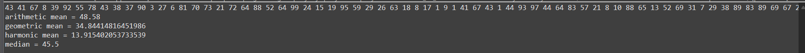


```java
import java.util.Scanner;

public class Homework13 {

    public static void main(String[] args) {

        Scanner scanner = new Scanner(System.in);

        while(true) {

            System.out.print("계산식 입력 (종료 q): ");
            String inputString = scanner.nextLine();

            if(inputString.equals("q")) {
                break;
            }

            String[] arrOfStr = inputString.split(" ");

            if(arrOfStr.length == 3) {

                double a = Double.parseDouble(arrOfStr[0]);
                String op = arrOfStr[1];
                double b = Double.parseDouble(arrOfStr[2]);

                double result = 0;

                if(op.equals("+")) {
                    result = a + b;
                }
                else if(op.equals("-")) {
                    result = a - b;
                }
                else if(op.equals("#")) {
                    result = a * b;
                }
                else if(op.equals("/")) {
                    result = a / b;
                }

                System.out.println("= " + result);
            }


            else if(arrOfStr.length == 5) {

                double a = Double.parseDouble(arrOfStr[0]);
                String op1 = arrOfStr[1];
                double b = Double.parseDouble(arrOfStr[2]);
                String op2 = arrOfStr[3];
                double c = Double.parseDouble(arrOfStr[4]);

                double result = 0;

                if((op1.equals("+") || op1.equals("-"))
                        && (op2.equals("#") || op2.equals("/"))) {

                    double temp = 0;

                    if(op2.equals("#")) {
                        temp = b * c;
                    }
                    else {
                        temp = b / c;
                    }

                    if(op1.equals("+")) {
                        result = a + temp;
                    }
                    else {
                        result = a - temp;
                    }
                }

                else {

                    double temp = 0;

                    if(op1.equals("+")) {
                        temp = a + b;
                    }
                    else if(op1.equals("-")) {
                        temp = a - b;
                    }
                    else if(op1.equals("#")) {
                        temp = a * b;
                    }
                    else if(op1.equals("/")) {
                        temp = a / b;
                    }

                    if(op2.equals("+")) {
                        result = temp + c;
                    }
                    else if(op2.equals("-")) {
                        result = temp - c;
                    }
                    else if(op2.equals("#")) {
                        result = temp * c;
                    }
                    else if(op2.equals("/")) {
                        result = temp / c;
                    }
                }

                System.out.println("= " + result);
            }
        }

        scanner.close();
    }
}
```

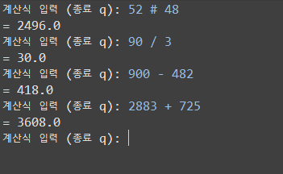
```java
public class Homework14 {

    int num[];

    Homework14(int num[]) {
        this.num = num;
    }

    double getTotal() {

        double sum = 0;

        for(int i=0; i<num.length; i++) {
            sum = sum + num[i];
        }

        return sum;
    }

    double getArithmeticMean() {

        return getTotal() / num.length;
    }

    double getHarmonicMean() {

        double sum = 0;

        for(int i=0; i<num.length; i++) {

            if(num[i] == 0) {
                return Double.NaN;
            }

            sum = sum + 1.0 / num[i];
        }

        return num.length / sum;
    }

    double getGeometricMean() {

        double product = 1;

        for(int i=0; i<num.length; i++) {

            if(num[i] == 0) {
                return 0;
            }

            product = product * num[i];
        }

        return Math.pow(product, 1.0 / num.length);
    }

    double getMedian() {

        sorting();

        if(num.length % 2 == 1) {

            return num[num.length / 2];
        }

        else {

            return (num[num.length / 2 - 1]
                    + num[num.length / 2]) / 2.0;
        }
    }

    void sorting() {

        for(int i=0; i<num.length-1; i++) {

            int min = i;

            for(int j=i+1; j<num.length; j++) {

                if(num[j] < num[min]) {
                    min = j;
                }
            }

            int temp = num[i];
            num[i] = num[min];
            num[min] = temp;
        }
    }

    void drawHistogram(int start, int end, int binCount, int scale) {

        int binSize = (end - start) / binCount;
        int hist[] = new int[binCount];

        for(int i=0; i<num.length; i++) {

            if(num[i] >= start && num[i] < end) {

                int bin = (num[i] - start) / binSize;
                hist[bin]++;
            }
        }

        for(int i=0; i<binCount; i++) {

            int rangeStart = start + i * binSize;
            int rangeEnd = rangeStart + binSize - 1;

            System.out.print(rangeStart + "~" + rangeEnd + "\t");

            for(int j=0; j<hist[i] / scale; j++) {
                System.out.print("#");
            }

            System.out.println();
        }
    }

    void display() {

        System.out.printf("%3d : ", num.length);

        for(int i=0; i<num.length; i++) {
            System.out.printf("%3d ", num[i]);
        }

        System.out.println();
    }
}
```

```java
public class Homework14_Test {

    public static void main(String[] args) {

        int size = 100;
        int data[] = new int[size];

        for(int i=0; i<size; i++) {
            data[i] = (int)(Math.random() * 100);
        }

        Homework14 obj = new Homework14(data);

        obj.display();

        System.out.printf(
                "Arithmetic Mean : %5.2f\n",
                obj.getArithmeticMean());

        System.out.printf(
                "Geometric Mean  : %5.2f\n",
                obj.getGeometricMean());

        System.out.printf(
                "Harmonic Mean   : %5.2f\n",
                obj.getHarmonicMean());

        System.out.printf(
                "Median          : %5.2f\n",
                obj.getMedian());

        System.out.println();

        obj.drawHistogram(0, 100, 10, 10);
    }
}
```

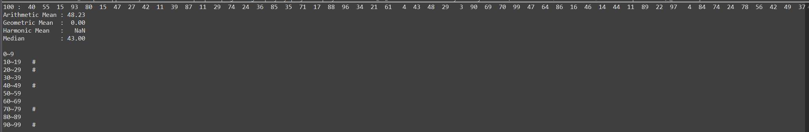

```java
public class C2048 {
    int value[][] = new int[4][4];
    int score;

    C2048() {
        init();
    }

    void init() {
        value = new int[4][4];
        score = 0;
        update();
        update();
    }

    void update() {
        int count = 0;

        for (int i=0; i<4; i++)
            for (int j=0; j<4; j++)
                if (value[i][j] == 0)
                    count++;

        if (count == 0)
            return;

        int n = (int)(Math.random()*count);

        for (int i=0; i<4; i++)
            for (int j=0; j<4; j++)
                if (value[i][j] == 0) {
                    if (n == 0) {
                        value[i][j] = ((int)(Math.random()*2)+1)*2;
                        return;
                    }
                    n--;
                }
    }

    void left() {
        move(0);
        display();
    }

    void right() {
        move(1);
        display();
    }

    void up() {
        move(2);
        display();
    }

    void down() {
        move(3);
        display();
    }

    void move(int direction) {
        boolean changed = false;

        for (int i=0; i<4; i++) {
            int temp[] = new int[4];
            int result[] = new int[4];
            int count = 0;

            for (int j=0; j<4; j++) {
                int x = direction < 2 ? i : (direction == 2 ? j : 3-j);
                int y = direction < 2 ? (direction == 0 ? j : 3-j) : i;

                if (value[x][y] != 0)
                    temp[count++] = value[x][y];
            }

            int k = 0;

            for (int j=0; j<count; j++) {
                if (j+1<count && temp[j] == temp[j+1]) {
                    result[k] = temp[j]*2;
                    score += result[k];
                    k++;
                    j++;
                }
                else
                    result[k++] = temp[j];
            }

            for (int j=0; j<4; j++) {
                int x = direction < 2 ? i : (direction == 2 ? j : 3-j);
                int y = direction < 2 ? (direction == 0 ? j : 3-j) : i;

                if (value[x][y] != result[j])
                    changed = true;
                value[x][y] = result[j];
            }
        }

        if (changed)
            update();
    }

    boolean gameOver() {
        for (int i=0; i<4; i++)
            for (int j=0; j<4; j++) {
                if (value[i][j] == 0)
                    return false;
                if (i<3 && value[i][j] == value[i+1][j])
                    return false;
                if (j<3 && value[i][j] == value[i][j+1])
                    return false;
            }
        return true;
    }

    boolean won() {
        for (int i=0; i<4; i++)
            for (int j=0; j<4; j++)
                if (value[i][j] >= 2048)
                    return true;
        return false;
    }

    void display() {
        for (int i=0; i<4; i++) {
            for (int j=0; j<4; j++)
                System.out.printf("%5d ", value[i][j]);
            System.out.println();
        }
        System.out.println();
    }
}
```
```java
import java.awt.*;
import java.awt.event.*;
import javax.swing.*;

public class C2048Player {
    C2048 obj = new C2048();
    JLabel tile[][] = new JLabel[4][4];
    JLabel scoreLabel = new JLabel();
    JLabel message = new JLabel(" ", SwingConstants.CENTER);
    Color colors[] = {
        new Color(0xCDC1B4), new Color(0xEEE4DA), new Color(0xEDE0C8),
        new Color(0xF2B179), new Color(0xF59563), new Color(0xF67C5F),
        new Color(0xF65E3B), new Color(0xEDCF72), new Color(0xEDCC61),
        new Color(0xEDC850), new Color(0xEDC53F), new Color(0xEDC22E)
    };

    void show() {
        JFrame frame = new JFrame("2048");
        frame.setDefaultCloseOperation(JFrame.EXIT_ON_CLOSE);
        frame.setResizable(false);

        JPanel panel = new JPanel(new BorderLayout(10, 10));
        panel.setBorder(BorderFactory.createEmptyBorder(15, 15, 15, 15));
        panel.setBackground(new Color(0xFAF8EF));

        JPanel top = new JPanel(new BorderLayout());
        top.setOpaque(false);
        scoreLabel.setFont(new Font("SansSerif", Font.BOLD, 20));
        JButton restart = new JButton("다시 시작");
        top.add(scoreLabel, BorderLayout.WEST);
        top.add(restart, BorderLayout.EAST);
        panel.add(top, BorderLayout.NORTH);

        JPanel board = new JPanel(new GridLayout(4, 4, 8, 8));
        board.setBackground(new Color(0xBBADA0));
        board.setBorder(BorderFactory.createEmptyBorder(8, 8, 8, 8));
        board.setPreferredSize(new Dimension(420, 420));

        for (int i=0; i<4; i++)
            for (int j=0; j<4; j++) {
                tile[i][j] = new JLabel("", SwingConstants.CENTER);
                tile[i][j].setOpaque(true);
                tile[i][j].setFont(new Font("SansSerif", Font.BOLD, 30));
                board.add(tile[i][j]);
            }

        panel.add(board, BorderLayout.CENTER);
        panel.add(message, BorderLayout.SOUTH);
        frame.setContentPane(panel);

        restart.addActionListener(e -> {
            obj.init();
            refresh();
        });

        int keys[] = {KeyEvent.VK_LEFT, KeyEvent.VK_RIGHT,
                      KeyEvent.VK_UP, KeyEvent.VK_DOWN};

        for (int i=0; i<4; i++) {
            final int direction = i;
            String name = "move" + i;
            panel.getInputMap(JComponent.WHEN_IN_FOCUSED_WINDOW)
                 .put(KeyStroke.getKeyStroke(keys[i], 0), name);
            panel.getActionMap().put(name, new AbstractAction() {
                public void actionPerformed(ActionEvent e) {
                    if (direction == 0)
                        obj.left();
                    else if (direction == 1)
                        obj.right();
                    else if (direction == 2)
                        obj.up();
                    else
                        obj.down();
                    refresh();
                }
            });
        }

        restart.setFocusable(false);
        refresh();
        frame.pack();
        frame.setLocationRelativeTo(null);
        frame.setVisible(true);
    }

    void refresh() {
        for (int i=0; i<4; i++)
            for (int j=0; j<4; j++) {
                int n = obj.value[i][j];
                tile[i][j].setText(n == 0 ? "" : String.valueOf(n));

                int index = 0;
                for (int k=n; k>1; k/=2)
                    index++;

                tile[i][j].setBackground(colors[Math.min(index, colors.length-1)]);
                tile[i][j].setForeground(n<=4 ? new Color(0x776E65) : Color.WHITE);
            }

        scoreLabel.setText("점수: " + obj.score);

        if (obj.gameOver())
            message.setText("게임 종료! 다시 시작을 누르세요.");
        else if (obj.won())
            message.setText("2048 달성! 계속 플레이할 수 있습니다.");
        else
            message.setText("방향키로 숫자를 이동하세요.");
    }

    public static void main(String args[]) {
        SwingUtilities.invokeLater(() -> new C2048Player().show());
    }
}

```
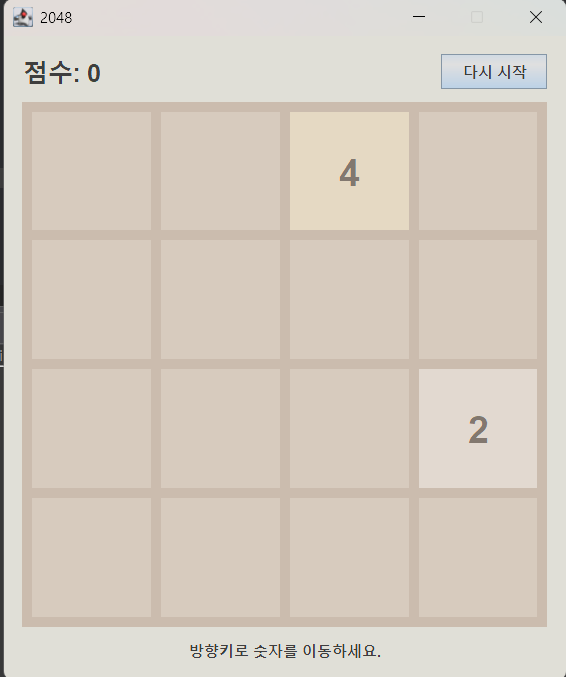
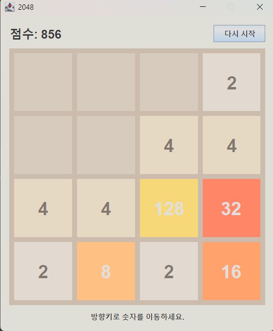
